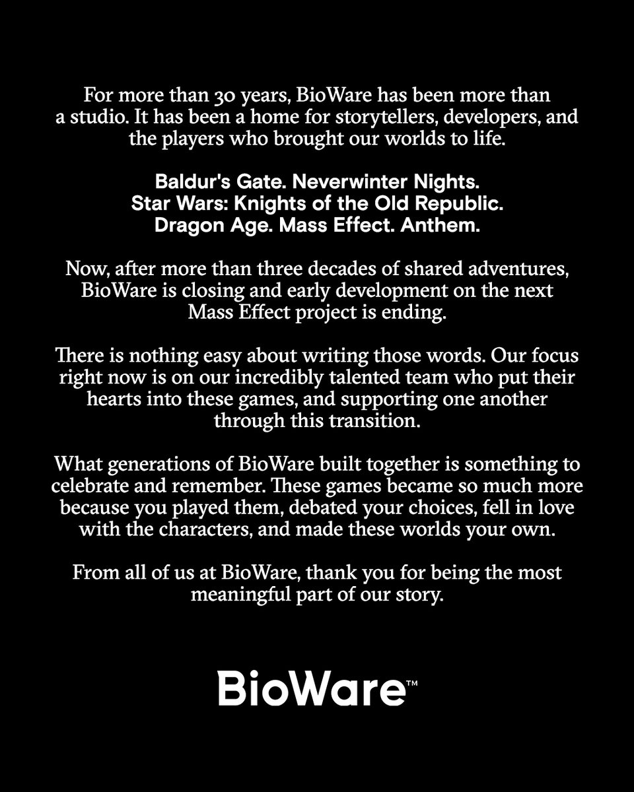
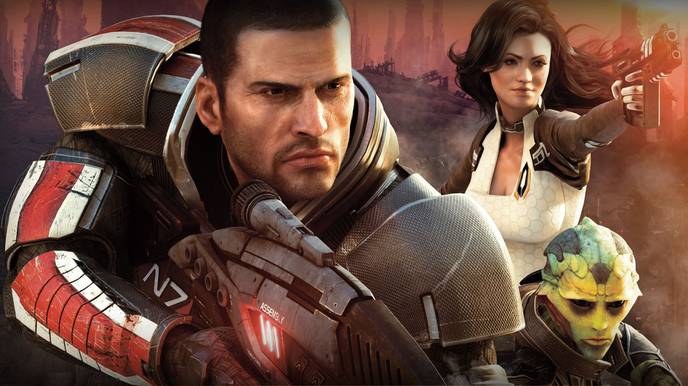

Arriva una notizia destinata a segnare l'industria videoludica: dopo oltre trent'anni di attività, **Electronic Arts ha annunciato la chiusura definitiva di BioWare** e la cancellazione del nuovo capitolo di *Mass Effect*.

La decisione si inserisce nel quadro di una [riorganizzazione interna avviata da Electronic Arts](https://gaming.hwupgrade.it/news/videogames/electronic-arts-avvia-una-profonda-riorganizzazione-e-bioware-chiude-i-battenti-dopo-oltre-30-anni-di-attivita_160918.html). In seguito alla maxi-operazione da 55 miliardi di dollari che ha portato la società a tornare privata, il publisher ha varato un piano di contenimento dei costi con il licenziamento di circa **400 dipendenti**. Tra i provvedimenti rientra la chiusura della sede storica di Edmonton, in Canada.

## Il comunicato ufficiale

L'annuncio è stato diffuso dallo studio sui canali social:

*Il messaggio pubblicato da BioWare su X ([Link al post](https://x.com/bioware/status/2112953618093535510/photo/1)).*

Nel messaggio, il team ripercorre brevemente le tappe fondamentali dello studio:

> *"Per oltre 30 anni, BioWare è stata più di un semplice studio. È stata una casa per narratori, sviluppatori e giocatori che hanno dato vita ai nostri mondi. Baldur's Gate. Neverwinter Nights. Star Wars: Knights of the Old Republic. Dragon Age. Mass Effect. Anthem. Ora, dopo oltre tre decenni di avventure condivise, BioWare chiude i battenti e lo sviluppo iniziale del prossimo progetto di Mass Effect si conclude."*

## La storia dello studio: dall'indipendenza all'acquisizione

La chiusura di BioWare chiude una parabola trentennale fondamentale per l'evoluzione dei giochi di ruolo su PC e console.

### Le origini e l'Infinity Engine (1995–2002)
Lo studio viene fondato a Edmonton nel **1995** da tre medici: **Ray Muzyka, Greg Zeschuk e Augustine Yip**. Dopo il debutto nel 1996 con il simulatore di mech *Shattered Steel* pubblicato da Interplay, la svolta arriva nel **1998** con **Baldur's Gate**, basato sulle regole di *Dungeons & Dragons* e sul motore proprietario *Infinity Engine*. 

Al successo di critica e pubblico fanno seguito **Baldur's Gate II: Shadows of Amn** (2000), lo sparatutto in terza persona **MDK2** (2000) e nel **2002** il passaggio al 3D con **Neverwinter Nights**, noto soprattutto per l'*Aurora Toolset*, uno strumento che ha permesso alla community di creare moduli e server persistenti.

### Il debutto su console e le nuove IP (2003–2007)
Nel **2003** lo studio pubblica **Star Wars: Knights of the Old Republic (KOTOR)** su Xbox e PC, dimostrando la fattibilità tecnica e commerciale di GDR complessi su console da salotto. Nel **2005** arriva **Jade Empire**, la prima proprietà intellettuale interamente originale dello studio, ambientata in un mondo ispirato alla mitologia e alle arti marziali cinesi.

### L'acquisizione da parte di EA (2007)
A ottobre 2007, per far fronte ai costi crescenti dello sviluppo su PlayStation 3 e Xbox 360, il gruppo formato da BioWare e Pandemic Studios viene acquisito da **Electronic Arts per circa 860 milioni di dollari**. Pochi mesi dopo esce il primo capitolo della saga fantascientifica **Mass Effect**, seguito nel 2009 dal fantasy **Dragon Age: Origins**.

 
*Mass Effect*

## Il decennio recente e la crisi

I primi anni sotto la gestione EA hanno prodotto risultati di altissimo livello come **Mass Effect 2** (2010), uno dei migliori videogiochi cui io abbia mai giocato.

A partire dal **2012**, tuttavia, sono iniziate le prime criticità:
- **L'addio dei fondatori:** Ray Muzyka e Greg Zeschuk lasciano l'azienda nel settembre 2012, in coincidenza con le polemiche sul finale di *Mass Effect 3* e il debutto dell'MMO *Star Wars: The Old Republic*.
- **Transizione tecnica e Frostbite:** L'obbligo imposto da EA di adottare l'engine Frostbite (nato per sparatutto in prima persona) ha comportato notevoli complessità tecniche sui titoli successivi, a partire da *Dragon Age: Inquisition* (2014), pur vincitore del Game of the Year.
- **Passi falsi commerciali:** Lo sviluppo travagliato di *Mass Effect: Andromeda* (2017) e soprattutto il fallimento del live-service *Anthem* (2019) hanno indebolito la posizione dello studio all'interno del gruppo EA.
- **Le difficoltà recenti:** Le alterne vicende produttive legate a *Dragon Age: The Veilguard* e i continui cambi al vertice creativo hanno progressivamente ridimensionato il ruolo della software house.

Con il piano di ristrutturazione annunciato da EA si interrompe anche il pre-sviluppo del nuovo *Mass Effect*, segnando la conclusione definitiva delle attività dello studio canadese dopo 31 anni.

---

**Fonte della notizia:** [Electronic Arts avvia una profonda riorganizzazione e BioWare chiude i battenti dopo oltre 30 anni di attività – Hardware Upgrade](https://gaming.hwupgrade.it/news/videogames/electronic-arts-avvia-una-profonda-riorganizzazione-e-bioware-chiude-i-battenti-dopo-oltre-30-anni-di-attivita_160918.html)
